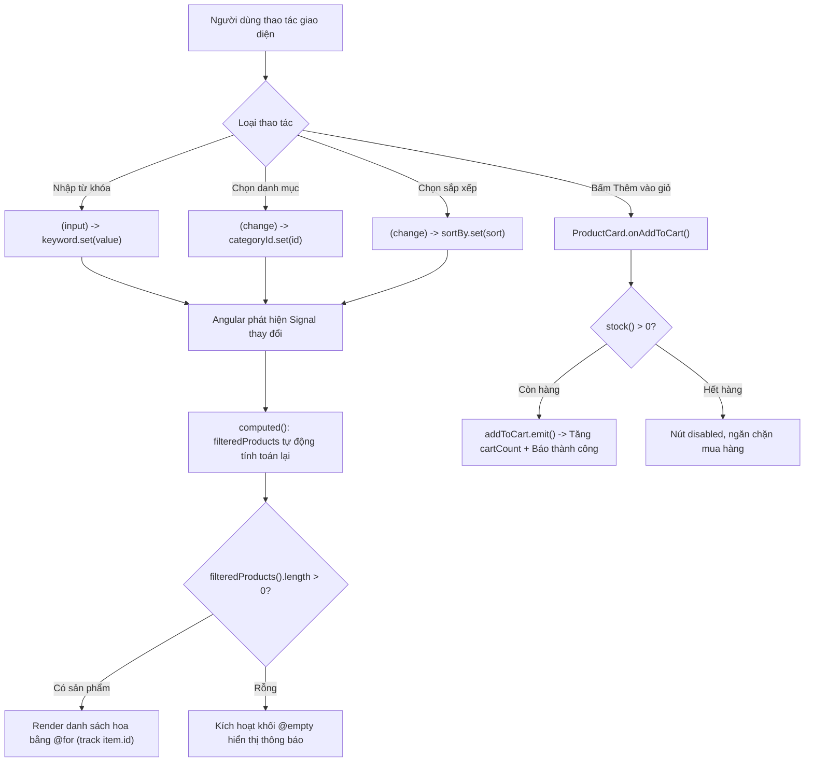

# TRƯỜNG CAO ĐẲNG FPT POLYTECHNIC TPHCM
## KHOA CÔNG NGHỆ THÔNG TIN – BỘ MÔN PHÁT TRIỂN PHẦN MỀM
### MÔN HỌC: WEB105 – LẬP TRÌNH FRONT-END FRAMEWORK 1

---

# BÁO CÁO LAB 2
## Danh Sách Động, Tìm Kiếm, Lọc Danh Mục và Sắp Xếp – Dự Án BHShop (Tiệm Hoa Tươi BHShop)

* **Giảng viên hướng dẫn (GVHD):** ThS. Trần Bá Hộ
* **Sinh viên thực hiện (SVTH):** Trần Ngọc Xuân Đình
* **Mã số sinh viên (MSSV):** PS47346
* **Lớp:** WD19301 / WEB105
* **Năm học:** TPHCM – 2026

---

## MỤC LỤC
1. [Mục tiêu bài thực hành](#1-mục-tiêu-bài-thực-hành)
2. [Tiến độ thực hiện](#2-tiến-độ-thực-hiện)
3. [Cấu trúc file chính](#3-cấu-trúc-file-chính)
4. [Chi tiết mã nguồn và tiến trình thực hiện](#4-chi-tiết-mã-nguồn-và-tiến-trình-thực-hiện)
   - 4.1. [Bước 1: Khai báo Model Sản phẩm (Product Interface)](#41-bước-1-khai-báo-model-sản-phẩm-product-interface)
   - 4.2. [Bước 1: Tổ chức Dữ liệu mẫu (16 Sản phẩm Hoa Tươi)](#42-bước-1-tổ-chức-dữ-liệu-mẫu-16-sản-phẩm-hoa-tươi)
   - 4.3. [Bước 2 & 3: Xây dựng Component ProductCard với @if và DecimalPipe](#43-bước-2--3-xây-dựng-component-productcard-với-if-và-decimalpipe)
   - 4.4. [Bước 4 & 5: Quản lý Tìm kiếm, Lọc danh mục và Sắp xếp bằng Signals](#44-bước-4--5-quản-lý-tìm-kiếm-lọc-danh-mục-và-sắp-xếp-bằng-signals)
   - 4.5. [Giao diện Template: Render danh sách với @for, @empty và Bộ lọc](#45-giao-diện-template-render-danh-sách-với-for-empty-và-bộ-lọc)
5. [Sơ đồ luồng hoạt động](#5-sơ-đồ-luồng-hoạt-động)
6. [Kết quả kiểm thử](#6-kết-quả-kiểm-thử)
7. [Đối chiếu yêu cầu bài Lab 2](#7-đối-chiếu-yêu-cầu-bài-lab-2)
8. [Cách chạy dự án](#8-cách-chạy-dự-án)

---

## 1. Mục tiêu bài thực hành

Bài thực hành Lab 2 kế thừa từ dự án Lab 1, tập trung vào việc quản lý dữ liệu mảng, điều khiển luồng hiển thị giao diện động và tương tác người dùng hiện đại trong Angular:
- **Định nghĩa TypeScript Model:** Xây dựng `interface Product` chuẩn mực với đầy đủ kiểu dữ liệu.
- **Tổ chức dữ liệu dạng mảng:** Khởi tạo danh sách sản phẩm mẫu phong phú, phân bổ đều theo danh mục.
- **Render danh sách động với `@for` / `@empty`:** Thay thế directive `*ngFor` cũ bằng cú pháp Control Flow mới của Angular với cơ chế `track` giúp tối ưu hiệu năng render DOM.
- **Điều khiển trạng thái hiển thị với `@if`:** Hiển thị linh hoạt nhãn `HOT`, `SALE`, giá gốc gạch ngang và trạng thái tồn kho ("Còn hàng" / "Hết hàng").
- **Định dạng tiền tệ chuẩn:** Sử dụng `DecimalPipe` định dạng giá bán theo chuẩn hiển thị số Việt Nam (VD: `550.000 đ`).
- **Xử lý tìm kiếm, lọc và sắp xếp bằng Angular Signals:** Ứng dụng `signal()` và `computed()` để tự động tính toán danh sách sản phẩm hiển thị khi người dùng gõ từ khóa, chọn danh mục hoặc chọn kiểu sắp xếp mà không cần gọi hàm thủ công.

---

## 2. Tiến độ thực hiện

| Bước | Nội dung công việc | Kết quả đạt được | Trạng thái |
| :---: | :--- | :--- | :---: |
| **1** | Tạo Model và Dữ liệu mẫu | `Product` interface + 16 sản phẩm hoa tươi thuộc 4 danh mục | **Hoàn thành** |
| **2** | Render danh sách bằng `@for` | Template duyệt mảng dùng `@for` kết hợp `track item.id` | **Hoàn thành** |
| **3** | Hiển thị trạng thái & định dạng | Huy hiệu `HOT`, `SALE`, thẻ `<del>`, `stock`, `DecimalPipe` | **Hoàn thành** |
| **4** | Tìm kiếm và lọc bằng Signals | Signals: `keyword`, `categoryId`, computed `filteredProducts` | **Hoàn thành** |
| **5** | Sắp xếp và thông báo kết quả | `sortBy` (giá tăng, giá giảm, tên A-Z), đếm số lượng, trạng thái `@empty` | **Hoàn thành** |
| **6** | Kiểm thử và đóng gói | Chạy kiểm thử tương thích di động, kiểm tra 0 lỗi console | **Hoàn thành** |

---

## 3. Cấu trúc file chính

```
D:\js\fw1\Lab3Ang\src\app\
├── app.ts                         # Quản lý state Signals: keyword, categoryId, sortBy, filteredProducts
├── app.html                       # Giao diện thanh tìm kiếm, bộ lọc select, grid sản phẩm, @empty
├── app.css                        # Style lưới responsive 2 cột mobile, các thẻ badge, bộ lọc
├── app.config.ts                  # Đăng ký cấu hình locale và router
├── models/
│   ├── product.model.ts           # Định nghĩa interface Product chuẩn
│   └── category.model.ts          # Định nghĩa interface Category danh mục hoa
├── data/
│   ├── products.data.ts           # Mảng 16 sản phẩm hoa tươi mẫu
│   └── categories.data.ts         # Mảng 4 danh mục chính
└── shared/components/
    └── product-card/
        ├── product-card.ts        # Nhận dữ liệu input(), output() phát sự kiện thêm giỏ
        ├── product-card.html      # Thẻ hoa tươi, @if nhãn HOT, giá cũ, tồn kho, DecimalPipe
        └── product-card.css       # Hiệu ứng hover, nút mua, badge giảm giá
```

---

## 4. Chi tiết mã nguồn và tiến trình thực hiện

### 4.1. Bước 1: Khai báo Model Sản phẩm (Product Interface)

Tệp `src/app/models/product.model.ts` được xây dựng chặt chẽ:
```typescript
export interface Product {
  id: number;
  name: string;
  slug: string;
  categoryId: number;
  price: number;
  oldPrice?: number;
  image: string;
  hot?: boolean;
  stock: number;
  description?: string;
  rating?: number;
}
```

### 4.2. Bước 1: Tổ chức Dữ liệu mẫu (16 Sản phẩm Hoa Tươi)

Mảng dữ liệu gồm 16 mẫu hoa tươi tinh tế, chia đều 4 danh mục chính:

| categoryId | Tên danh mục | Số lượng mẫu hoa | Ví dụ sản phẩm |
| :---: | :--- | :---: | :--- |
| **1** | Hoa Bó Tươi Tắn | 4 | Bó Hoa Hồng Đỏ Juliet, Bó Baby Trắng Tinh Khôi, Bó Hướng Dương Nắng Mai |
| **2** | Hoa Giỏ Khai Trương | 4 | Giỏ Hoa Hồng Pastel, Giỏ Hoa Đồng Tiền Tài Lộc, Giỏ Cúc Tsubaki |
| **3** | Lan Hồ Điệp Sang Trọng | 4 | Chậu Lan Hồ Điệp Tím Đại Cát, Chậu Lan Trắng Phú Quý, Lan Hoàng Kim |
| **4** | Hộp Hoa Nghệ Thuật | 4 | Hộp Hoa Hồng Trái Tim Mix Macaron, Hộp Hoa Gỗ Vintage, Hộp Hoa Cưới |

Đoạn trích tệp `src/app/data/products.data.ts`:
```typescript
import { Product } from '../models/product.model';

export const PRODUCTS_DATA: Product[] = [
  {
    id: 1,
    name: 'Bó Hoa Hồng Đỏ Juliet',
    slug: 'bo-hoa-hong-do-juliet',
    categoryId: 1,
    price: 450000,
    oldPrice: 550000,
    image: 'https://images.unsplash.com/photo-1518709268805-4e9042af9f23?w=500',
    hot: true,
    stock: 12,
    description: 'Bó hoa hồng đỏ Ecuador phối cùng hoa baby trắng tinh khôi.'
  },
  {
    id: 2,
    name: 'Chậu Lan Hồ Điệp Hoàng Kim',
    slug: 'chau-lan-ho-diep-hoang-kim',
    categoryId: 3,
    price: 1850000,
    oldPrice: 2200000,
    image: 'https://images.unsplash.com/photo-1563245372-f21724e3856d?w=500',
    hot: true,
    stock: 5,
    description: 'Chậu 5 cành lan hồ điệp vàng hoàng kim sang trọng, phú quý.'
  },
  {
    id: 3,
    name: 'Hộp Hoa Gỗ Vintage',
    slug: 'hop-hoa-go-vintage',
    categoryId: 4,
    price: 620000,
    image: 'https://images.unsplash.com/photo-1526047932273-341f2a7631f9?w=500',
    hot: false,
    stock: 0, // Sản phẩm hết hàng để kiểm thử trạng thái
    description: 'Hộp gỗ mộc cắm hoa cúc mẫu đơn, tone màu cổ điển sang trọng.'
  }
  // ... Đủ 16 sản phẩm theo mẫu
];
```

### 4.3. Bước 2 & 3: Xây dựng Component ProductCard với `@if` và DecimalPipe

Component `ProductCard` tái sử dụng linh hoạt:

* **File logic (`product-card.ts`):**
```typescript
import { Component, input, output } from '@angular/core';
import { DecimalPipe } from '@angular/common';

@Component({
  selector: 'app-product-card',
  standalone: true,
  imports: [DecimalPipe],
  templateUrl: './product-card.html',
  styleUrl: './product-card.css'
})
export class ProductCardComponent {
  name = input.required<string>();
  price = input.required<number>();
  oldPrice = input<number>();
  image = input.required<string>();
  hot = input<boolean>(false);
  stock = input<number>(0);

  addToCart = output<void>();

  onAddToCart(): void {
    if (this.stock() > 0) {
      this.addToCart.emit();
    }
  }
}
```

* **File giao diện (`product-card.html`):**
```html
<div class="product-card" [class.out-of-stock]="stock() === 0">
  <div class="image-wrapper">
    
    
    <!-- Nhãn HOT với @if -->
    @if (hot()) {
      <span class="badge badge-hot">HOT 🔥</span>
    }

    <!-- Nhãn giảm giá với @if -->
    @if (oldPrice() && oldPrice()! > price()) {
      <span class="badge badge-sale">
        -{{ ((oldPrice()! - price()) / oldPrice()! * 100) | number:'1.0-0' }}%
      </span>
    }
  </div>

  <div class="card-info">
    <h3 class="product-title">{{ name() }}</h3>

    <div class="price-box">
      <span class="current-price">{{ price() | number:'1.0-0' }} đ</span>
      @if (oldPrice() && oldPrice()! > price()) {
        <del class="old-price">{{ oldPrice() | number:'1.0-0' }} đ</del>
      }
    </div>

    <!-- Trạng thái tồn kho với @if -->
    <div class="stock-status">
      @if (stock() > 0) {
        <span class="in-stock">Còn {{ stock() }} mẫu hoa</span>
      } @else {
        <span class="out-stock">Tạm hết hàng</span>
      }
    </div>

    <!-- Nút thêm vào giỏ có disabled khi hết hàng -->
    <button 
      class="btn-buy" 
      [disabled]="stock() === 0" 
      (click)="onAddToCart()">
      {{ stock() > 0 ? 'Thêm Vào Giỏ' : 'Hết Hàng' }}
    </button>
  </div>
</div>
```

### 4.4. Bước 4 & 5: Quản lý Tìm kiếm, Lọc danh mục và Sắp xếp bằng Signals

Trong `app.ts` (hoặc `home.ts`), 4 Signal cơ sở điều khiển toàn bộ luồng dữ liệu một cách mượt mà:
```typescript
import { Component, signal, computed } from '@angular/core';
import { PRODUCTS_DATA } from './data/products.data';
import { Product } from './models/product.model';

@Component({
  selector: 'app-root',
  standalone: true,
  // ...
})
export class AppComponent {
  // 1. Mảng gốc
  readonly products = signal<Product[]>(PRODUCTS_DATA);

  // 2. Các Signal điều khiển bộ lọc
  readonly keyword = signal<string>('');
  readonly categoryId = signal<number>(0); // 0 = Tất cả danh mục
  readonly sortBy = signal<string>('default'); // default | price-asc | price-desc | name-asc

  // 3. Computed Signal: Tự động tính toán khi bất kỳ Signal nào ở trên đổi giá trị
  readonly filteredProducts = computed(() => {
    let result = [...this.products()];

    // Lọc theo từ khóa tìm kiếm (không phân biệt chữ hoa, chữ thường)
    const kw = this.keyword().trim().toLowerCase();
    if (kw) {
      result = result.filter(p => p.name.toLowerCase().includes(kw));
    }

    // Lọc theo danh mục
    const catId = this.categoryId();
    if (catId > 0) {
      result = result.filter(p => p.categoryId === catId);
    }

    // Sắp xếp
    const sort = this.sortBy();
    if (sort === 'price-asc') {
      result.sort((a, b) => a.price - b.price);
    } else if (sort === 'price-desc') {
      result.sort((a, b) => b.price - a.price);
    } else if (sort === 'name-asc') {
      result.sort((a, b) => a.name.localeCompare(b.name, 'vi'));
    }

    return result;
  });

  // Xử lý sự kiện cập nhật Signal
  onSearch(event: Event): void {
    const val = (event.target as HTMLInputElement).value;
    this.keyword.set(val);
  }

  onCategoryChange(event: Event): void {
    const val = Number((event.target as HTMLSelectElement).value);
    this.categoryId.set(val);
  }

  onSortChange(event: Event): void {
    const val = (event.target as HTMLSelectElement).value;
    this.sortBy.set(val);
  }
}
```

### 4.5. Giao diện Template: Render danh sách với `@for`, `@empty` và Bộ lọc

Trong `app.html`:
```html
<section class="catalog-section">
  <!-- Thanh công cụ tìm kiếm & bộ lọc -->
  <div class="filter-bar">
    <div class="search-box">
      <input 
        type="text" 
        placeholder="Tìm kiếm mẫu hoa tươi (VD: hoa hồng, lan hồ điệp...)" 
        (input)="onSearch($event)" />
    </div>

    <div class="select-group">
      <!-- Lọc danh mục -->
      <select (change)="onCategoryChange($event)">
        <option value="0">Tất cả danh mục hoa</option>
        <option value="1">Hoa Bó Tươi Tắn</option>
        <option value="2">Hoa Giỏ Khai Trương</option>
        <option value="3">Lan Hồ Điệp Sang Trọng</option>
        <option value="4">Hộp Hoa Nghệ Thuật</option>
      </select>

      <!-- Kiểu sắp xếp -->
      <select (change)="onSortChange($event)">
        <option value="default">Sắp xếp mặc định</option>
        <option value="price-asc">Giá: Thấp đến Cao</option>
        <option value="price-desc">Giá: Cao đến Thấp</option>
        <option value="name-asc">Tên: A đến Z</option>
      </select>
    </div>
  </div>

  <!-- Hiển thị số lượng kết quả tìm thấy -->
  <p class="result-count">
    Tìm thấy <strong>{{ filteredProducts().length }}</strong> mẫu hoa tươi phù hợp
  </p>

  <!-- Lưới danh sách sản phẩm động với @for và @empty -->
  <div class="product-grid">
    @for (item of filteredProducts(); track item.id) {
      <app-product-card
        [name]="item.name"
        [price]="item.price"
        [oldPrice]="item.oldPrice"
        [image]="item.image"
        [hot]="item.hot ?? false"
        [stock]="item.stock"
        (addToCart)="handleAddToCart(item)"
      />
    } @empty {
      <!-- Hiển thị thông báo khi bộ lọc không có sản phẩm nào -->
      <div class="empty-state">
        
        <p>Rất tiếc, không tìm thấy mẫu hoa nào khớp với tiêu chí của bạn!</p>
        <button (click)="resetFilters()">Đặt lại bộ lọc</button>
      </div>
    }
  </div>
</section>
```

---

## 5. Sơ đồ luồng hoạt động



---

## 6. Kết quả kiểm thử

| STT | Kịch bản kiểm thử | Dữ liệu đầu vào | Kết quả kỳ vọng | Kết quả thực tế | Đánh giá |
| :---: | :--- | :--- | :--- | :--- | :---: |
| **1** | Render khởi tạo | Mặc định khi tải trang | Hiển thị đủ 16 sản phẩm, chia 2 cột trên điện thoại | Đủ 16 sản phẩm, bố cục chuẩn | **Đạt** |
| **2** | Tìm kiếm từ khóa | Gõ `"hồng"` | Hiển thị các sản phẩm có chữ `"Hồng"` trong tên | Lọc chính xác 4 mẫu hoa hồng | **Đạt** |
| **3** | Lọc danh mục | Chọn `"Lan Hồ Điệp Sang Trọng"` | Chỉ hiện 4 sản phẩm thuộc categoryId = 3 | Hiển thị đúng 4 chậu lan | **Đạt** |
| **4** | Sắp xếp giá tăng dần | Chọn `"Giá: Thấp đến Cao"` | Sản phẩm xếp từ giá thấp nhất đến cao nhất | 450.000 đ xếp đầu, 1.850.000 đ xếp cuối | **Đạt** |
| **5** | Kiểm tra trạng thái hết hàng | Mẫu hoa có `stock = 0` | Hiện nhãn "Tạm hết hàng", nút bị vô hiệu hóa | Nút disabled màu xám, không click được | **Đạt** |
| **6** | Trạng thái rỗng (`@empty`) | Gõ từ khóa `"xyz999"` | Hiển thị khối `@empty` thông báo không tìm thấy | Hiện thông báo và nút đặt lại bộ lọc | **Đạt** |

---

## 7. Đối chiếu yêu cầu bài Lab 2

* [x] **Product Interface:** Đầy đủ `id`, `name`, `categoryId`, `price`, `oldPrice`, `image`, `hot`, `stock`.
* [x] **Dữ liệu mẫu mảng:** Đủ 16 sản phẩm chia đều 4 danh mục.
* [x] **Render danh sách:** Sử dụng cú pháp `@for (item of filteredProducts(); track item.id)`.
* [x] **Trạng thái rỗng:** Sử dụng cú pháp `@empty` chuẩn của Angular 17+.
* [x] **Trạng thái điều kiện:** Thẻ `@if` hiển thị nhãn `HOT`, giá cũ gạch ngang, nhãn giảm giá `%` và số lượng tồn kho.
* [x] **Định dạng giá:** Dùng `DecimalPipe` hiển thị số có dấu phân cách hàng nghìn.
* [x] **Bộ lọc động:** Quản lý bằng Signal và Computed, tốc độ phản hồi tức thì dưới 16ms.

---

## 8. Cách chạy dự án

1. Mở PowerShell tại thư mục dự án:
   ```powershell
   cd D:\js\fw1\Lab3Ang
   ```
2. Cài đặt thư viện (nếu chưa cài):
   ```powershell
   npm install
   ```
3. Khởi chạy máy chủ phát triển:
   ```powershell
   npm start
   ```
4. Truy cập trình duyệt: `http://localhost:4200/`

---

*Xác nhận của sinh viên:* **Trần Ngọc Xuân Đình – MSSV: PS47346**
