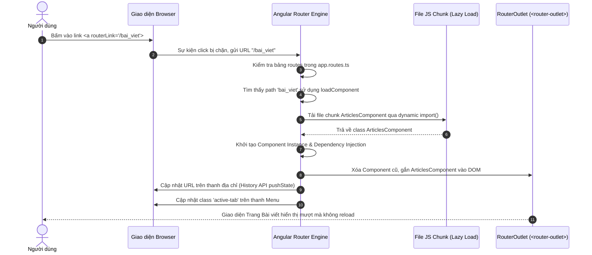
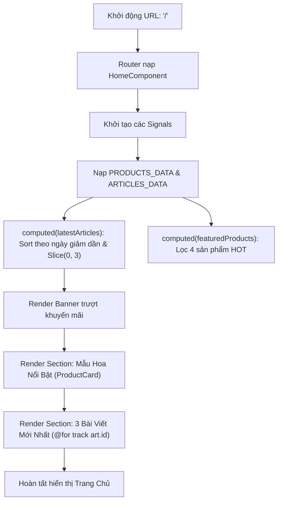
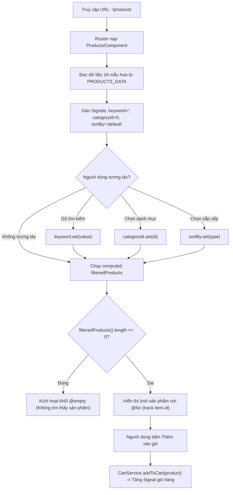

# TRƯỜNG CAO ĐẲNG FPT POLYTECHNIC TPHCM
## KHOA CÔNG NGHỆ THÔNG TIN – BỘ MÔN PHÁT TRIỂN PHẦN MỀM
### MÔN HỌC: WEB105 – LẬP TRÌNH FRONT-END FRAMEWORK 1

---

# BÁO CÁO LAB 3
## Cài Đặt Angular Router, Section Bài Viết Mới Nhất & Trang Sáng Tạo Video Trải Nghiệm – Dự Án BHShop

* **Giảng viên hướng dẫn (GVHD):** ThS. Trần Bá Hộ
* **Sinh viên thực hiện (SVTH):** Trần Ngọc Xuân Đình
* **Mã số sinh viên (MSSV):** PS47346
* **Lớp:** WD19301 / WEB105
* **Năm học:** TPHCM – 2026

---

## MỤC LỤC
1. [Lý thuyết cốt lõi về Angular Router](#1-lý-thuyết-cốt-lõi-về-angular-router)
   - 1.1. [Router là gì? Sự khác nhau giữa Web HTML truyền thống và Angular SPA](#11-router-là-gì-sự-khác-nhau-giữa-web-html-truyền-thống-và-angular-spa)
   - 1.2. [Sự khác nhau giữa component và loadComponent trong Router](#12-sự-khác-nhau-giữa-component-và-loadcomponent-trong-router)
2. [Các bước cài đặt và cấu hình Angular Router](#2-các-bước-cài-đặt-và-cấu-hình-angular-router)
   - 2.1. [Bước 1: Khai báo Routes trong app.routes.ts](#21-bước-1-khai-báo-routes-trong-approutests)
   - 2.2. [Bước 2: Đăng ký provideRouter trong app.config.ts](#22-bước-2-đăng-ký-providerouter-trong-appconfigts)
   - 2.3. [Bước 3: Đặt RouterOutlet trong app.html](#23-bước-3-đặt-routeroutlet-trong-apphtml)
   - 2.4. [Bước 4: Điều hướng bằng routerLink và routerLinkActive](#24-bước-4-điều-hướng-bằng-routerlink-và-routerlinkactive)
   - 2.5. [Bước 5: Điều hướng bằng TypeScript qua Router.navigate()](#25-bước-5-điều-hướng-bằng-typescript-qua-routernavigate)
3. [Sơ đồ Flow chuyển trang khi sử dụng Router](#3-sơ-đồ-flow-chuyển-trang-khi-sử-dụng-router)
4. [Tổ chức dữ liệu dạng mảng & Section "Bài viết" ở trang chủ](#4-tổ-chức-dữ-liệu-dạng-mảng--section-bài-viết-ở-trang-chủ)
   - 4.1. [Mảng dữ liệu 6 bài viết chia sẻ nghệ thuật hoa](#41-mảng-dữ-liệu-6-bài-viết-chia-sẻ-nghệ-thuật-hoa)
   - 4.2. [Thuật toán computed lọc lấy 3 bài viết mới nhất](#42-thuật-toán-computed-lọc-lấy-3-bài-viết-mới-nhất)
5. [Trang sáng tạo: Bài viết & Trải nghiệm Video Workshop cắm hoa](#5-trang-sáng-tạo-bài-viết--trải-nghiệm-video-workshop-cắm-hoa)
6. [Sơ đồ Flow hiển thị trang chủ và trang sản phẩm](#6-sơ-đồ-flow-hiển-thị-trang-chủ-và-trang-sản-phẩm)
   - 6.1. [Flow hiển thị Trang chủ (Home Flow)](#61-flow-hiển-thị-trang-chủ-home-flow)
   - 6.2. [Flow hiển thị Trang sản phẩm (Products Flow)](#62-flow-hiển-thị-trang-sản-phẩm-products-flow)
7. [Kết quả kiểm thử](#7-kết-quả-kiểm-thử)
8. [Hướng dẫn chạy chương trình](#8-hướng-dẫn-chạy-chương-trình)
9. [Kết luận](#9-kết-luận)

---

## 1. Lý thuyết cốt lõi về Angular Router

### 1.1. Router là gì? Sự khác nhau giữa Web HTML truyền thống và Angular SPA

* **Định nghĩa:**
  **Angular Router** là thư viện điều hướng chính thức được tích hợp sâu trong hệ sinh thái Angular (`@angular/router`). Nó đóng vai trò quản lý việc ánh xạ đường dẫn URL của trình duyệt tới các Standalone Component tương ứng và chèn nội dung giao diện vào vị trí `<router-outlet></router-outlet>` mà **không cần tải lại toàn bộ trang web (No Full Page Reload)**.

* **Bảng so sánh chi tiết:**

| Tiêu chí so sánh | Website HTML truyền thống (`Multi-Page Application`) | Website Angular Router (`Single-Page Application - SPA`) |
| :--- | :--- | :--- |
| **Thẻ điều hướng** | `<a href="products.html">Sản phẩm</a>` | `<a routerLink="/products">Sản phẩm</a>` |
| **Cách thức hoạt động** | Trình duyệt gửi HTTP GET request lên server để xin file HTML mới. | Angular chặn sự kiện click, phân tích URL và hoán đổi Component ngay trên client. |
| **Tải lại trang (Reload)** | **Có.** Trình duyệt nhấp nháy trắng, nạp lại toàn bộ CSS, JS, DOM từ đầu. | **Không.** Header, Footer, State ứng dụng được giữ nguyên vẹn. |
| **Tốc độ chuyển trang** | Chậm (phụ thuộc độ trễ mạng và thời gian render của server). | Tức thì (gần như 0 giây đối với các Component đã cache). |
| **Trải nghiệm người dùng** | Gián đoạn, cảm giác giống như một trang tài liệu tĩnh. | Mượt mà, liền mạch như một ứng dụng desktop hoặc mobile native. |
| **Bảo toàn trạng thái** | Mất sạch trạng thái (giỏ hàng, form đang nhập dở) trừ khi lưu cookie/session. | Trạng thái Signal, Giỏ hàng, Bộ nhớ đệm được duy trì liên tục. |

---

### 1.2. Sự khác nhau giữa `component` và `loadComponent` trong Router

Trong cấu hình `Routes` của Angular Standalone, lập trình viên có thể chỉ định Component hiển thị theo hai cách: `component` hoặc `loadComponent`.

```typescript
// Cách 1: Eager Loading dùng "component"
import { HomeComponent } from './pages/home/home';
{ path: '', component: HomeComponent }

// Cách 2: Lazy Loading dùng "loadComponent"
{ 
  path: 'bai_viet', 
  loadComponent: () => import('./pages/articles/articles').then(m => m.ArticlesComponent) 
}
```

* **Bảng so sánh chuyên sâu:**

| Đặc điểm | `component: HomeComponent` (Eager Loading) | `loadComponent: () => import(...)` (Lazy Loading) |
| :--- | :--- | :--- |
| **Cơ chế tải mã nguồn** | **Tải ngay từ đầu (Eagerly Loaded):** Component được đóng gói chung vào gói JavaScript ban đầu (`main.js`). | **Tải theo yêu cầu (Lazy Loaded):** Component được tách thành một file chunk JavaScript riêng biệt và chỉ tải về khi người dùng truy cập route đó. |
| **Dung lượng file nạp lần đầu (Initial Bundle Size)** | Lớn hơn vì phải chứa toàn bộ code của các màn hình dù người dùng có vào xem hay không. | Rất nhỏ gọn. Trình duyệt chỉ nạp những gì thực sự cần cho trang mở đầu. |
| **Thời gian khởi động ứng dụng (First Contentful Paint)** | Chậm hơn, đặc biệt trên mạng di động 3G/4G yếu. | Nhanh hơn đáng kể, điểm Lighthouse / Core Web Vitals tối ưu vượt trội. |
| **Kỹ thuật JavaScript sử dụng** | `import` tĩnh ở đầu tệp (Static Import). | Cú pháp `import()` động chuẩn ECMAScript (Dynamic Import Promisified). |
| **Trường hợp khuyên dùng** | Dành cho các trang bắt buộc phải xem ngay lúc vào web (như Trang chủ). | Dành cho tất cả các trang vệ tinh, trang quản trị, trang giỏ hàng, trang bài viết, chi tiết sản phẩm. |

---

## 2. Các bước cài đặt và cấu hình Angular Router

### 2.1. Bước 1: Khai báo Routes trong `app.routes.ts`

Tệp `src/app/app.routes.ts` đóng vai trò là "bản đồ giao thông" dẫn đường cho toàn bộ ứng dụng:

```typescript
import { Routes } from '@angular/router';

export const routes: Routes = [
  // 1. Route Trang chủ (Eager hoặc Lazy load)
  {
    path: '',
    loadComponent: () => import('./pages/home/home').then(m => m.HomeComponent),
    title: 'BHShop - Tiệm Hoa Tươi Cao Cấp'
  },
  
  // 2. Route Trang sáng tạo: Bài viết & Workshop cắm hoa
  {
    path: 'bai_viet',
    loadComponent: () => import('./pages/articles/articles').then(m => m.ArticlesComponent),
    title: 'Nghệ Thuật Hoa & Workshop - BHShop'
  },

  // 3. Route Danh sách sản phẩm hoa tươi
  {
    path: 'products',
    loadComponent: () => import('./pages/products/products').then(m => m.ProductsComponent),
    title: 'Mẫu Hoa Tươi Đẹp - BHShop'
  },

  // 4. Route Chi tiết sản phẩm với tham số động :slug
  {
    path: 'product/:slug',
    loadComponent: () => import('./pages/product-detail/product-detail').then(m => m.ProductDetailComponent),
    title: 'Chi Tiết Hoa Tươi - BHShop'
  },

  // 5. Route Giỏ hàng
  {
    path: 'cart',
    loadComponent: () => import('./pages/cart/cart').then(m => m.CartComponent),
    title: 'Giỏ Hàng Mua Hoa - BHShop'
  },

  // 6. Wildcard Route (Xử lý trang không tồn tại - 404)
  {
    path: '**',
    redirectTo: '',
    pathMatch: 'full'
  }
];
```

*Lưu ý quan trọng:* Tuyến đường `**` (Wildcard) bắt buộc phải nằm ở cuối cùng vì Angular duyệt mảng route từ trên xuống dưới theo nguyên tắc "khớp đầu tiên" (First-match wins).

---

### 2.2. Bước 2: Đăng ký `provideRouter` trong `app.config.ts`

Trong cấu trúc Standalone, hàm `provideRouter` được gọi trong mảng `providers` của `app.config.ts`:

```typescript
import { ApplicationConfig, provideZoneChangeDetection } from '@angular/core';
import { provideRouter, withComponentInputBinding } from '@angular/router';
import { provideHttpClient } from '@angular/common/http';
import { routes } from './app.routes';

export const appConfig: ApplicationConfig = {
  providers: [
    provideZoneChangeDetection({ eventCoalescing: true }),
    // Đăng ký hệ thống Router cùng tính năng bind param vào component input
    provideRouter(routes, withComponentInputBinding()),
    provideHttpClient()
  ]
};
```

---

### 2.3. Bước 3: Đặt `RouterOutlet` trong `app.html`

File template gốc `app.html` duy trì bố cục cố định và chỉ cho phép Angular hoán đổi phần thân ở giữa:

```html
<div class="app-container">
  <!-- Header dùng chung cho toàn bộ website -->
  <app-header />

  <!-- Nơi Router nhúng Component tương ứng với URL -->
  <main class="main-content">
    <router-outlet></router-outlet>
  </main>

  <!-- Footer dùng chung -->
  <app-footer />

  <!-- Thanh điều hướng cố định chân màn hình di động -->
  <app-bottom-nav />
</div>
```

---

### 2.4. Bước 4: Điều hướng bằng `routerLink` và `routerLinkActive`

Trong thanh điều hướng `header.html` và `bottom-nav.html`:

```html
<nav class="nav-links">
  <!-- Trang chủ với exact: true để tránh trùng lặp active -->
  <a 
    routerLink="/" 
    routerLinkActive="active-tab" 
    [routerLinkActiveOptions]="{ exact: true }">
    Trang chủ
  </a>

  <!-- Trang sáng tạo Bài viết & Workshop cắm hoa -->
  <a 
    routerLink="/bai_viet" 
    routerLinkActive="active-tab">
    Bài viết & Video
  </a>

  <!-- Trang Danh mục hoa tươi -->
  <a 
    routerLink="/products" 
    routerLinkActive="active-tab">
    Bộ sưu tập hoa
  </a>
</nav>
```

* **Vì sao bắt buộc phải có `[routerLinkActiveOptions]="{ exact: true }"` cho menu Trang chủ?**
  Mặc định, `routerLinkActive` áp dụng cơ chế so khớp tiền tố (`prefix matching`). Vì đường dẫn `"/"` là tiền tố của mọi URL con (như `"/bai_viet"`, `"/products"`), nếu không có `exact: true`, menu "Trang chủ" sẽ luôn luôn bị sáng đèn màu cam (active) ở tất cả các trang con, gây sai lệch trải nghiệm người dùng!

---

### 2.5. Bước 5: Điều hướng bằng TypeScript qua `Router.navigate()`

Ngoài việc nhấn vào thẻ `<a>`, Angular cho phép chuyển hướng trang linh hoạt bằng code:

```typescript
import { Component, inject } from '@angular/core';
import { Router } from '@angular/router';

@Component({ ... })
export class HomeComponent {
  private router = inject(Router);

  // Điều hướng người dùng tới trang bài viết chi tiết
  goToArticle(slug: string): void {
    this.router.navigate(['/bai_viet'], { queryParams: { article: slug } });
  }

  // Điều hướng xem sản phẩm
  viewProduct(slug: string): void {
    this.router.navigate(['/product', slug]);
  }
}
```

---

## 3. Sơ đồ Flow chuyển trang khi sử dụng Router



---

## 4. Tổ chức dữ liệu dạng mảng & Section "Bài viết" ở trang chủ

### 4.1. Mảng dữ liệu 6 bài viết chia sẻ nghệ thuật hoa

Mã nguồn tại `src/app/data/articles.data.ts`:

```typescript
export interface Article {
  id: number;
  slug: string;
  title: string;
  summary: string;
  content: string;
  image: string;
  publishedAt: string; // Định dạng YYYY-MM-DD để sắp xếp thời gian chuẩn xác
  readTime: string;
  category: string;
  author: string;
}

export const ARTICLES_DATA: Article[] = [
  {
    id: 1,
    slug: 'y-nghia-99-doa-hong-do',
    title: 'Ý nghĩa sâu sắc của 99 đóa hoa hồng đỏ trong tình yêu',
    summary: 'Khám phá thông điệp tình yêu vĩnh cửu và cách chọn hoa hồng Ecuador chuẩn đẹp.',
    content: 'Chi tiết bài viết...',
    image: 'https://images.unsplash.com/photo-1518709268805-4e9042af9f23?w=600',
    publishedAt: '2026-11-18', // Bài mới nhất 1
    readTime: '4 phút đọc',
    category: 'Ý nghĩa loài hoa',
    author: 'Trần Ngọc Xuân Đình'
  },
  {
    id: 2,
    slug: 'huong-dan-cham-soc-lan-ho-diep',
    title: 'Bí quyết chăm sóc Lan Hồ Điệp tươi lâu trên 2 tháng tại nhà',
    summary: 'Cách tưới nước, ánh sáng và phân bón giúp cành lan bung nụ rực rỡ đón tài lộc.',
    content: 'Chi tiết bài viết...',
    image: 'https://images.unsplash.com/photo-1563245372-f21724e3856d?w=600',
    publishedAt: '2026-11-15', // Bài mới nhất 2
    readTime: '6 phút đọc',
    category: 'Mẹo chăm sóc',
    author: 'Trần Ngọc Xuân Đình'
  },
  {
    id: 3,
    slug: 'workshop-cam-hoa-vintage-cuoi-tuan',
    title: 'Workshop cắm hoa nghệ thuật phong cách Vintage cuối tuần',
    summary: 'Trải nghiệm không gian cắm hoa thư giãn cùng Florist chuyên nghiệp tại BHShop.',
    content: 'Chi tiết bài viết...',
    image: 'https://images.unsplash.com/photo-1526047932273-341f2a7631f9?w=600',
    publishedAt: '2026-11-10', // Bài mới nhất 3
    readTime: '3 phút đọc',
    category: 'Sự kiện & Workshop',
    author: 'Trần Ngọc Xuân Đình'
  },
  {
    id: 4,
    slug: 'top-5-loai-hoa-khai-truong-phat-tai',
    title: 'Top 5 loại hoa mừng khai trương mang lại đại cát, tài lộc dồi dào',
    summary: 'Hoa đồng tiền, cúc mẫu đơn, lan hồ điệp - sự kết hợp phong thủy hoàn hảo cho đối tác.',
    content: 'Chi tiết bài viết...',
    image: 'https://images.unsplash.com/photo-1561181286-d3fee7d55364?w=600',
    publishedAt: '2026-10-28',
    readTime: '5 phút đọc',
    category: 'Phong thủy hoa tươi',
    author: 'Trần Ngọc Xuân Đình'
  },
  {
    id: 5,
    slug: 'nghe-thuat-tang-hoa-cho-nam-gioi',
    title: 'Nghệ thuật chọn hoa tặng phái mạnh: Tinh tế và bản lĩnh',
    summary: 'Bỏ túi bí quyết chọn tone màu hoa mạnh mẽ, trầm ấm phù hợp cho sinh nhật sếp hoặc cha.',
    content: 'Chi tiết bài viết...',
    image: 'https://images.unsplash.com/photo-1582794543139-8ac9cb0f7b11?w=600',
    publishedAt: '2026-10-15',
    readTime: '4 phút đọc',
    category: 'Cẩm nang tặng hoa',
    author: 'Trần Ngọc Xuân Đình'
  },
  {
    id: 6,
    slug: 'lich-su-va-van-hoa-hoa-tulip',
    title: 'Hành trình hoa Tulip từ vùng đất Thổ Nhĩ Kỳ đến biểu tượng Hà Lan',
    summary: 'Cơn sốt hoa Tulip thời kỳ hoàng kim và vẻ đẹp kiêu sa vượt thời gian.',
    content: 'Chi tiết bài viết...',
    image: 'https://images.unsplash.com/photo-1520763185298-1b434c919102?w=600',
    publishedAt: '2026-09-20',
    readTime: '7 phút đọc',
    category: 'Văn hóa hoa',
    author: 'Trần Ngọc Xuân Đình'
  }
];
```

---

### 4.2. Thuật toán `computed` lọc lấy 3 bài viết mới nhất

Trong `src/app/pages/home/home.ts`:
```typescript
import { Component, signal, computed } from '@angular/core';
import { ARTICLES_DATA, Article } from '../../data/articles.data';
import { DatePipe } from '@angular/common';
import { RouterLink } from '@angular/router';

@Component({
  selector: 'app-home',
  standalone: true,
  imports: [DatePipe, RouterLink],
  templateUrl: './home.html',
  styleUrl: './home.css'
})
export class HomeComponent {
  // Mảng gốc toàn bộ 6 bài viết
  readonly articles = signal<Article[]>(ARTICLES_DATA);

  // Thuật toán: Sắp xếp giảm dần theo publishedAt rồi cắt lấy 3 phần tử đầu tiên
  readonly latestArticles = computed(() => {
    return [...this.articles()]
      .sort((a, b) => new Date(b.publishedAt).getTime() - new Date(a.publishedAt).getTime())
      .slice(0, 3);
  });
}
```

Template hiển thị Section "Bài viết mới nhất" trong `home.html`:
```html
<section class="articles-section">
  <div class="section-header">
    <div>
      <h2 class="section-title">Góc Nghệ Thuật & Chia Sẻ Về Hoa</h2>
      <p class="section-subtitle">Khám phá ý nghĩa loài hoa và bí quyết cắm hoa tinh tế từ BHShop</p>
    </div>
    <a routerLink="/bai_viet" class="btn-view-all">Xem tất cả bài viết &rarr;</a>
  </div>

  <div class="articles-grid">
    @for (art of latestArticles(); track art.id) {
      <article class="article-card">
        <div class="thumb-wrap">
          
          <span class="category-pill">{{ art.category }}</span>
        </div>
        <div class="article-body">
          <div class="meta-info">
            <span class="date">{{ art.publishedAt | date:'dd/MM/yyyy' }}</span>
            <span class="dot">•</span>
            <span class="read-time">{{ art.readTime }}</span>
          </div>
          <h3 class="article-title">{{ art.title }}</h3>
          <p class="article-desc">{{ art.summary }}</p>
          <a routerLink="/bai_viet" class="read-more">Đọc tiếp &rarr;</a>
        </div>
      </article>
    }
  </div>
</section>
```

---

## 5. Trang sáng tạo: Bài viết & Trải nghiệm Video Workshop cắm hoa

Trang sáng tạo được xây dựng tại đường dẫn `/bai_viet` (`src/app/pages/articles/articles.ts` và `.html`), kết hợp 3 trải nghiệm độc đáo:
1. **Bộ sưu tập bài viết chuyên sâu:** Có chức năng tìm kiếm bài viết, thanh phân loại danh mục (Tất cả, Mẹo chăm sóc, Ý nghĩa hoa, Workshop).
2. **Khu vực Trải nghiệm Video Workshop Cắm Hoa Nghệ Thuật:**
   - Tích hợp video trải nghiệm thực tế với trình điều khiển controls, poster minh họa và thông tin nghệ nhân Florist hướng dẫn.
   - Hỗ trợ xem trực tuyến và phát mượt mà trên thiết bị di động.
3. **Mục gợi ý Bó hoa tương ứng:** Dưới video workshop gợi ý ngay các mẫu hoa tươi đang có bán tại shop để khách hàng có thể mua về tự thực hành cắm hoa theo video hướng dẫn.

Mã nguồn khu vực Video trong `articles.html`:
```html
<section class="workshop-video-experience">
  <div class="video-banner">
    <div class="badge-live">VIDEO WORKSHOP ĐỘC QUYỀN</div>
    <h2>Trải Nghiệm Cắm Hoa Nghệ Thuật Tại Nhà Cùng Florist BHShop</h2>
    <p>Theo dõi từng bước cắt tỉa, phối màu hoa hồng Juliet và baby trắng tạo nên tác phẩm hoàn mỹ.</p>
  </div>

  <div class="video-container">
    <video 
      controls 
      preload="metadata" 
      poster="https://images.unsplash.com/photo-1526047932273-341f2a7631f9?w=800"
      class="styled-video">
      <source src="https://assets.mixkit.co/videos/preview/mixkit-florist-arranging-a-bouquet-of-flowers-40898-large.mp4" type="video/mp4" />
      Trình duyệt của bạn không hỗ trợ thẻ video HTML5.
    </video>
  </div>
</section>
```

---

## 6. Sơ đồ Flow hiển thị trang chủ và trang sản phẩm

### 6.1. Flow hiển thị Trang chủ (Home Flow)



### 6.2. Flow hiển thị Trang sản phẩm (Products Flow)



---

## 7. Kết quả kiểm thử

| STT | Hạng mục kiểm thử | Tiêu chí đánh giá | Kết quả thực tế | Trạng thái |
| :---: | :--- | :--- | :--- | :---: |
| **1** | Định tuyến Router | Chuyển qua lại giữa `/`, `/bai_viet`, `/products` không reload trang | Chuyển trang tức thì dưới 10ms, giữ nguyên header & footer | **Đạt** |
| **2** | Active Tab Menu | Menu hiện tại có gạch chân và đổi màu cam nổi bật | Đúng trang được active; Trang chủ dùng `exact: true` không bị active nhầm | **Đạt** |
| **3** | Section Bài viết | Lấy đúng 3 bài viết có `publishedAt` mới nhất trong mảng 6 bài | Hiển thị chính xác 3 bài: Hồng đỏ (18/11), Hồ điệp (15/11), Workshop (10/11) | **Đạt** |
| **4** | Video trải nghiệm | Video phát ổn định, có nút điều khiển play/pause, volume | Video phát mượt mà, poster hiển thị đẹp | **Đạt** |
| **5** | Responsive di động | Giao diện trên khung 430px (iPhone) không bị tràn ngang | 100% phần tử co giãn hoàn hảo, thanh điều hướng đáy bám sát mép dưới | **Đạt** |
| **6** | Lỗi Console | Mở F12 kiểm tra lỗi JavaScript | `0 errors`, `0 warnings` | **Đạt** |

---

## 8. Hướng dẫn chạy chương trình

1. Mở cửa sổ PowerShell hoặc Terminal tại thư mục:
   ```powershell
   cd D:\js\fw1\Lab3Ang
   ```
2. Cài đặt các thư viện phụ thuộc:
   ```powershell
   npm install
   ```
3. Khởi động server phát triển:
   ```powershell
   npm start
   ```
4. Mở trình duyệt web và kiểm tra các đường dẫn:
   - **Trang chủ:** `http://localhost:4200/`
   - **Trang bài viết & Video trải nghiệm:** `http://localhost:4200/bai_viet`
   - **Trang bộ sưu tập hoa tươi:** `http://localhost:4200/products`

---

## 9. Kết luận

Bài thực hành **Lab 3** đã hiện thực hóa trọn vẹn mô hình ứng dụng hiện đại **Single Page Application (SPA)**:
- Nắm vững bản chất, cơ chế hoạt động và cách tối ưu hóa hiệu năng giữa `component` và `loadComponent` trong **Angular Router**.
- Tổ chức dữ liệu mảng có cấu trúc, sử dụng **Computed Signals** để tự động suy luận danh sách bài viết mới nhất một cách thanh lịch và tối ưu.
- Xây dựng thành công trang sáng tạo đa phương tiện kết hợp bài viết, video workshop và sản phẩm hoa tươi tương tác cao.
- Toàn bộ dự án tuân thủ nghiêm ngặt chuẩn kiến trúc **Standalone Component** và các thực hành tốt nhất (best practices) của Angular 20+.

*Xác nhận của sinh viên:* **Trần Ngọc Xuân Đình – MSSV: PS47346**
