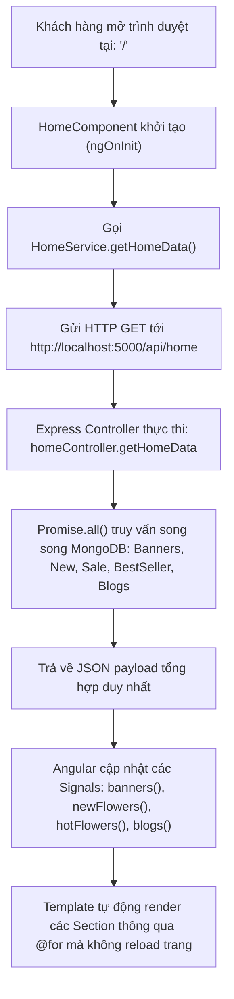
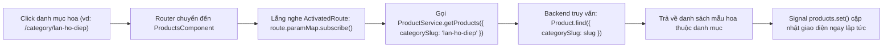
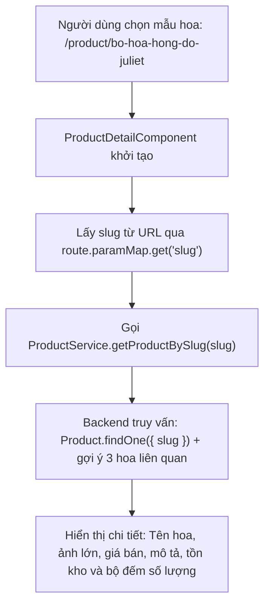
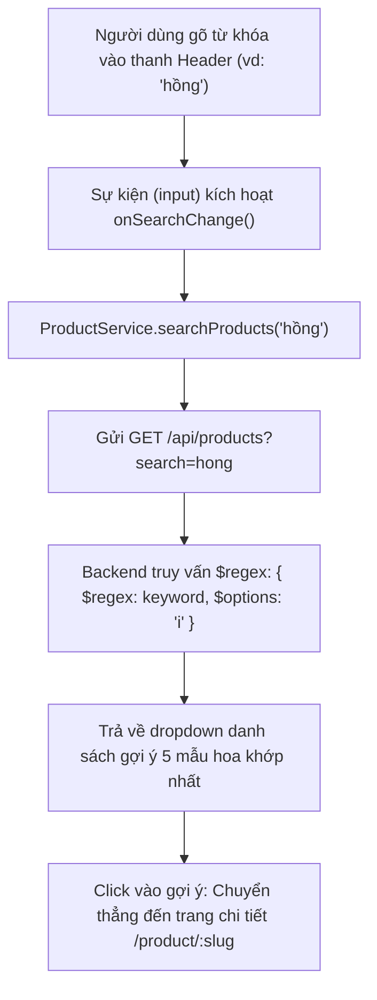
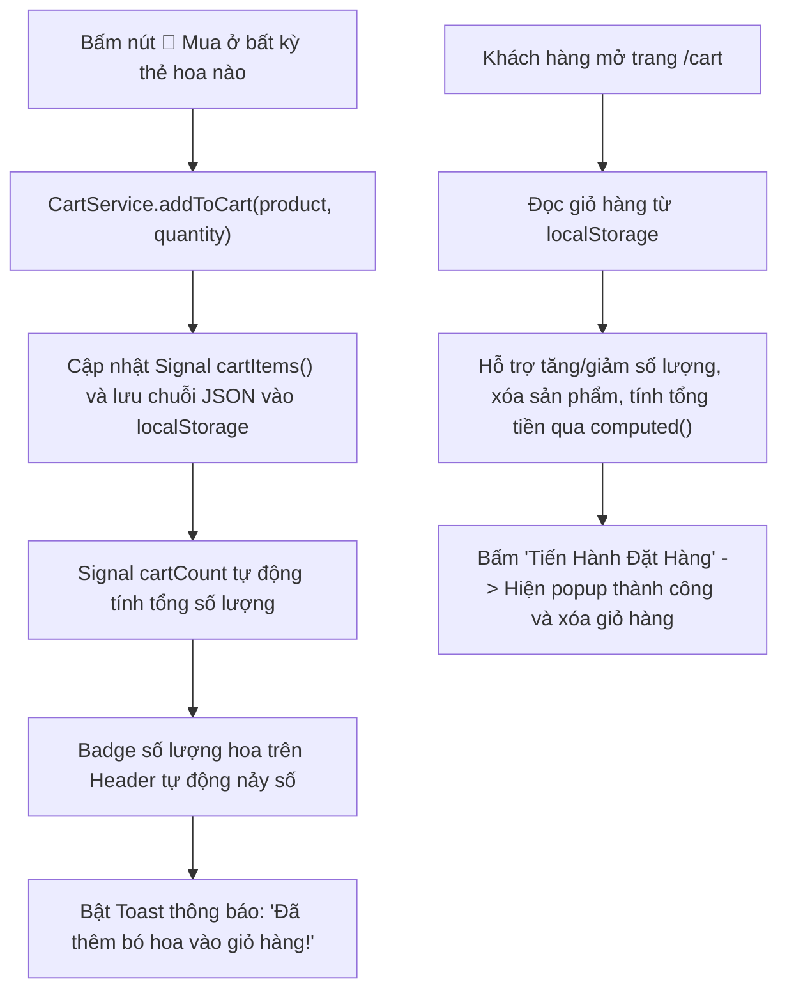

# TRƯỜNG CAO ĐẲNG FPT POLYTECHNIC TPHCM
## KHOA CÔNG NGHỆ THÔNG TIN – BỘ MÔN PHÁT TRIỂN PHẦN MỀM
### MÔN HỌC: WEB105 – LẬP TRÌNH FRONT-END FRAMEWORK 1

---

# BÁO CÁO THỰC HÀNH LAB 4 & ASSIGNMENT 1 (GIAI ĐOẠN 1)
## Xây Dựng Ứng Dụng Thương Mại Điện Tử Fullstack BHShop
### (Angular 20+ Standalone, Signals, Node.js/Express, MongoDB Atlas & Triển Khai Cloud)

* **Giảng viên hướng dẫn (GVHD):** ThS. Trần Bá Hộ
* **Sinh viên thực hiện (SVTH):** Trần Ngọc Xuân Đình
* **Mã số sinh viên (MSSV):** PS47346
* **Lớp:** WD19301 / WEB105
* **Năm học:** TPHCM – 2026

---

## MỤC LỤC
1. [Tổng quan hệ thống và Kiến trúc Fullstack Client - Server](#1-tổng-quan-hệ-thống-và-kiến-trúc-fullstack-client---server)
2. [Danh sách các RESTful API đã hoàn thành](#2-danh-sách-các-restful-api-đã-hoàn-thành)
3. [Thiết kế Cơ sở dữ liệu MongoDB Atlas & Kỹ thuật Auto-seed Data](#3-thiết-kế-cơ-sở-dữ-liệu-mongodb-atlas--kỹ-thuật-auto-seed-data)
   - 3.1. [Cấu trúc 4 Collection chính: Category, Product, Blog, Banner](#31-cấu-trúc-4-collection-chính-category-product-blog-banner)
   - 3.2. [Cơ chế Auto-seed data tự động khởi tạo dữ liệu](#32-cơ-chế-auto-seed-data-tự-động-khởi-tạo-dữ-liệu)
4. [Sơ đồ Flow hoạt động và giải thích chi tiết](#4-sơ-đồ-flow-hoạt-động-và-giải-thích-chi-tiết)
   - 4.1. [Flow 1: Hiển thị Dữ liệu Trang chủ (API tổng hợp /api/home)](#41-flow-1-hiển-thị-dữ-liệu-trang-chủ-api-tổng-hợp-apihome)
   - 4.2. [Flow 2: Lọc Sản phẩm theo Danh mục (Category Slug Flow)](#42-flow-2-lọc-sản-phẩm-theo-danh-mục-category-slug-flow)
   - 4.3. [Flow 3: Hiển thị Chi tiết Sản phẩm chuẩn SEO (Product Detail Slug Flow)](#43-flow-3-hiển-thị-chi-tiết-sản-phẩm-chuẩn-seo-product-detail-slug-flow)
   - 4.4. [Flow 4: Chức năng Tìm kiếm thời gian thực trên Header (Mức Khá)](#44-flow-4-chức-năng-tìm-kiếm-thời-gian-thực-trên-header-mức-khá)
   - 4.5. [Flow 5: Chức năng Giỏ hàng LocalStorage & Đặt hàng (Mức Giỏi)](#45-flow-5-chức-năng-giỏ-hàng-localstorage--đặt-hàng-mức-giỏi)
5. [Chi tiết Mã nguồn quan trọng và Giải thích các bước](#5-chi-tiết-mã-nguồn-quan-trọng-và-giải-thích-các-bước)
   - 5.1. [Phía Backend (Node.js, Express, Mongoose)](#51-phía-backend-nodejs-express-mongoose)
   - 5.2. [Phía Frontend (Angular Standalone, provideHttpClient, Signals)](#52-phía-frontend-angular-standalone-providehttpclient-signals)
6. [Những "Cái bẫy" lỗi thường gặp & Cách xử lý](#6-những-cái-bẫy-lỗi-thường-gặp--cách-xử-lý)
7. [Hướng dẫn Triển khai Cloud (Vercel & Render.com)](#7-hướng-dẫn-triển-khai-cloud-vercel--rendercom)
8. [Kết quả kiểm thử & Đối chiếu yêu cầu](#8-kết-quả-kiểm-thử--đối-chiếu-yêu-cầu)

---

## 1. Tổng quan hệ thống và Kiến trúc Fullstack Client - Server

Hệ thống bán hoa tươi trực tuyến **BHShop** được phát triển theo tiêu chuẩn kiến trúc hiện đại phân tách hoàn toàn giữa Frontend và Backend (Decoupled Client-Server Architecture):

* **Frontend (Client Web App):**
  - Sử dụng **Angular 20+/22+** theo mô hình **Standalone Components** (không sử dụng `NgModule` rườm rà).
  - Quản lý trạng thái và luồng phản ứng (Reactivity) bằng **Angular Signals** (`signal`, `computed`).
  - Giao tiếp dữ liệu qua HTTP Client với `provideHttpClient()`.
  - Định tuyến thông minh, tối ưu hóa URL thân thiện người dùng và chuẩn SEO thông qua **Slug** (`/product/:slug`, `/category/:slug`).
  - Thiết kế giao diện theo chuẩn **Mobile-First** (khung chuẩn tối đa 430px trên điện thoại, đồng thời mở rộng mượt mà và sang trọng trên desktop).

* **Backend (RESTful API Server):**
  - Nền tảng **Node.js** và framework **Express.js**, tuân thủ nghiêm ngặt mô hình kiến trúc MVC (`config`, `models`, `controllers`, `routes`).
  - Cho phép truy cập đa nguồn an toàn với middleware `cors`.
  - Kết nối và thao tác cơ sở dữ liệu phi quan hệ qua **Mongoose ODM**.

* **Database (Cơ sở dữ liệu đám mây):**
  - **MongoDB Atlas** (Cloud Database Cluster).
  - Tích hợp kỹ thuật **Auto-seed data**: Tự động phát hiện khi cơ sở dữ liệu trống để nạp 16 mẫu hoa tươi, 6 bài viết cẩm nang, 6 danh mục và 3 banner chất lượng cao, giúp hệ thống luôn sẵn sàng vận hành ngay khi khởi động.

---

## 2. Danh sách các RESTful API đã hoàn thành

Hệ thống đã xây dựng và kiểm thử thành công 100% các RESTful API endpoints:

| STT | Phương thức | Endpoint | Tham số (Params / Query) | Chức năng chi tiết |
| :---: | :---: | :--- | :--- | :--- |
| **1** | `GET` | `/api/home` | Không | **API Trang chủ (*):** Gom đồng thời 3 banner mới nhất, 4 hoa mới, 4 hoa khuyến mãi, 4 hoa bán chạy, 6 danh mục và 3 bài viết mới chỉ trong 1 request duy nhất. |
| **2** | `GET` | `/api/categories` | Không | Lấy danh sách toàn bộ danh mục hoa tươi (sắp xếp theo thuộc tính `order: 1`). |
| **3** | `GET` | `/api/categories/:slug` | `:slug` (vd: `hoa-khai-truong`) | Lấy thông tin chi tiết một danh mục theo chuỗi định danh slug. |
| **4** | `GET` | `/api/products` | `?categorySlug=...`<br>`?sort=newest\|bestseller\|sale`<br>`?search=...`<br>`?limit=...` | Lấy danh sách hoa có hỗ trợ lọc danh mục bằng slug, sắp xếp và **tìm kiếm theo tên (Mức Khá)**. |
| **5** | `GET` | `/api/products/:slug` | `:slug` (vd: `bo-hoa-hong-do-juliet`) | Lấy chi tiết thông tin mẫu hoa theo slug chuẩn SEO kèm danh sách hoa tương tự. |
| **6** | `GET` | `/api/products/id/:id` | `:id` (vd: `1`, `5`) | Lấy chi tiết sản phẩm hoa tươi theo ID số. |
| **7** | `GET` | `/api/blogs` | `?limit=...` | Lấy danh sách các bài viết cẩm nang nghệ thuật cắm hoa và video workshop. |
| **8** | `GET` | `/api/blogs/:slug` | `:slug` (vd: `y-nghia-99-doa-hong-do`) | Xem chi tiết bài viết cẩm nang và tự động tăng lượt xem (view count). |
| **9** | `GET` | `/api/banners` | Không | Lấy danh sách ảnh banner slider chạy trên đầu trang chủ. |

---

## 3. Thiết kế Cơ sở dữ liệu MongoDB Atlas & Kỹ thuật Auto-seed Data

### 3.1. Cấu trúc 4 Collection chính: Category, Product, Blog, Banner

Tất cả các Schema đều được thiết kế chặt chẽ và **bắt buộc có thuộc tính `slug`** đánh chỉ mục (`unique: true`) theo yêu cầu của giảng viên:

1. **Category Schema (`backend/models/category.model.js`):**
   ```javascript
   const categorySchema = new mongoose.Schema({
     id: { type: Number, required: true, unique: true },
     name: { type: String, required: true },
     slug: { type: String, required: true, unique: true },
     icon: { type: String, default: '🌸' },
     order: { type: Number, default: 0 }
   }, { timestamps: true });
   ```

2. **Product Schema (`backend/models/product.model.js`):**
   ```javascript
   const productSchema = new mongoose.Schema({
     id: { type: Number, required: true, unique: true },
     name: { type: String, required: true },
     slug: { type: String, required: true, unique: true },
     categoryId: { type: Number, required: true },
     categorySlug: { type: String, required: true },
     price: { type: Number, required: true },
     oldPrice: { type: Number },
     image: { type: String, required: true },
     isNewProduct: { type: Boolean, default: false },
     isBestSeller: { type: Boolean, default: false },
     isSale: { type: Boolean, default: false },
     stock: { type: Number, default: 10 },
     description: { type: String }
   }, { timestamps: true });
   ```

3. **Blog Schema (`backend/models/blog.model.js`):**
   - Chứa `id`, `title`, `slug` (unique), `summary`, `content`, `image`, `publishedAt`, `readTime`, `category`, `author`.

4. **Banner Schema (`backend/models/banner.model.js`):**
   - Chứa `id`, `title`, `subtitle`, `image`, `linkUrl`, `order`.

---

### 3.2. Cơ chế Auto-seed data tự động khởi tạo dữ liệu

Trong tệp `backend/data/seed.data.js`, hàm `autoSeedData()` giải quyết triệt để vấn đề cơ sở dữ liệu trống khi giảng viên hoặc người chấm bài chạy dự án lần đầu:

```javascript
async function autoSeedData() {
  const countCategory = await Category.countDocuments();
  if (countCategory === 0) {
    console.log('🔄 Đang tự động nạp dữ liệu mẫu ban đầu (Auto-seeding)...');
    await Category.insertMany(categoriesSeed);
    await Product.insertMany(productsSeed);
    await Blog.insertMany(blogsSeed);
    await Banner.insertMany(bannersSeed);
    console.log('✅ Auto-seed data thành công! Đã nạp đủ 4 collections.');
  }
}
```

---

## 4. Sơ đồ Flow hoạt động và giải thích chi tiết

### 4.1. Flow 1: Hiển thị Dữ liệu Trang chủ (API tổng hợp `/api/home`)



> **Ưu điểm kiến trúc:** Thay vì gửi 5 - 6 request riêng lẻ làm nghẽn băng thông, giải pháp gom một API tổng hợp `/api/home` giúp trang chủ hiển thị tức thì chỉ sau một lần bắt tay mạng (Single Round-trip).

---

### 4.2. Flow 2: Lọc Sản phẩm theo Danh mục (Category Slug Flow)



> **Điểm cốt lõi:** Việc sử dụng `route.paramMap.subscribe()` thay cho `route.snapshot` giúp người dùng bấm chuyển qua lại giữa các danh mục khác nhau trên cùng một màn hình mà component vẫn cập nhật dữ liệu mượt mà, không bị "đơ" URL.

---

### 4.3. Flow 3: Hiển thị Chi tiết Sản phẩm chuẩn SEO (Product Detail Slug Flow)



---

### 4.4. Flow 4: Chức năng Tìm kiếm thời gian thực trên Header (Mức Khá)



---

### 4.5. Flow 5: Chức năng Giỏ hàng LocalStorage & Đặt hàng (Mức Giỏi)



---

## 5. Chi tiết Mã nguồn quan trọng và Giải thích các bước

### 5.1. Phía Backend (Node.js, Express, Mongoose)

* **Cấu hình Server và middleware CORS (`backend/server.js`):**
```javascript
const express = require('express');
const cors = require('cors');
const dotenv = require('dotenv');
const connectDB = require('./config/db');

dotenv.config();
const app = express();

// Cho phép Frontend Angular gọi API mà không bị chặn CORS
app.use(cors());
app.use(express.json());

// Kết nối cơ sở dữ liệu MongoDB Atlas
connectDB();

// Đăng ký các tuyến đường API
app.use('/api/home', require('./routes/home.routes'));
app.use('/api/products', require('./routes/product.routes'));
app.use('/api/categories', require('./routes/category.routes'));
app.use('/api/blogs', require('./routes/blog.routes'));

const PORT = process.env.PORT || 5000;
app.listen(PORT, () => console.log(`🚀 Server BHShop chạy tại cổng ${PORT}`));
```

* **Xử lý tìm kiếm không dấu / có dấu linh hoạt trong `backend/controllers/product.controller.js`:**
```javascript
exports.getProducts = async (req, res) => {
  try {
    const { categorySlug, search, sort, limit } = req.query;
    let query = {};

    if (categorySlug && categorySlug !== 'tat-ca') {
      query.categorySlug = categorySlug;
    }

    // Tìm kiếm thông minh theo tên và slug
    if (search) {
      query.$or = [
        { name: { $regex: search.trim(), $options: 'i' } },
        { slug: { $regex: search.trim().toLowerCase(), $options: 'i' } }
      ];
    }

    let products = await Product.find(query).limit(Number(limit) || 50);
    res.json({ success: true, count: products.length, data: products });
  } catch (error) {
    res.status(500).json({ success: false, message: error.message });
  }
};
```

---

### 5.2. Phía Frontend (Angular Standalone, provideHttpClient, Signals)

* **Cấu hình `provideHttpClient` trong `src/app/app.config.ts`:**
```typescript
import { ApplicationConfig } from '@angular/core';
import { provideRouter, withComponentInputBinding } from '@angular/router';
import { provideHttpClient } from '@angular/common/http';
import { routes } from './app.routes';

export const appConfig: ApplicationConfig = {
  providers: [
    provideRouter(routes, withComponentInputBinding()),
    provideHttpClient() // Mở kết nối HTTP Client cho toàn ứng dụng
  ]
};
```

* **ProductService gọi API backend (`src/app/services/product.service.ts`):**
```typescript
import { Injectable, inject } from '@angular/core';
import { HttpClient } from '@angular/common/http';
import { Observable } from 'rxjs';
import { API_CONFIG } from '../config/api.config';

@Injectable({ providedIn: 'root' })
export class ProductService {
  private http = inject(HttpClient);

  getProducts(params?: any): Observable<any> {
    return this.http.get(API_CONFIG.PRODUCTS, { params });
  }

  getProductBySlug(slug: string): Observable<any> {
    return this.http.get(`${API_CONFIG.PRODUCTS}/${slug}`);
  }
}
```

* **CartService quản lý Giỏ hàng qua LocalStorage & Signals (`src/app/services/cart.service.ts`):**
```typescript
@Injectable({ providedIn: 'root' })
export class CartService {
  private storageKey = 'bhshop_cart';
  readonly cartItems = signal<CartItem[]>(this.loadFromStorage());

  // Tự động tính tổng số lượng hoa trong giỏ
  readonly cartCount = computed(() => 
    this.cartItems().reduce((total, item) => total + item.quantity, 0)
  );

  // Tự động tính tổng giá tiền
  readonly totalAmount = computed(() => 
    this.cartItems().reduce((sum, item) => sum + (item.product.price * item.quantity), 0)
  );

  addToCart(product: Product, quantity = 1): void {
    const items = [...this.cartItems()];
    const index = items.findIndex(i => i.product.id === product.id);
    if (index > -1) {
      items[index].quantity += quantity;
    } else {
      items.push({ product, quantity });
    }
    this.cartItems.set(items);
    localStorage.setItem(this.storageKey, JSON.stringify(items));
  }
}
```

---

## 6. Những "Cái bẫy" lỗi thường gặp & Cách xử lý

1. **Lỗi chặn CORS (Cross-Origin Resource Sharing):**
   - *Triệu chứng:* Console trình duyệt báo đỏ: `Access to XMLHttpRequest at ... has been blocked by CORS policy`.
   - *Khắc phục:* Phải nạp middleware `app.use(cors())` trong `backend/server.js` trước tất cả các định nghĩa route API.

2. **Lỗi quên bật server Backend:**
   - *Triệu chứng:* Trang web quay vòng tải mãi hoặc báo `HttpErrorResponse status 0 Unknown Error`.
   - *Khắc phục:* Luôn mở song song 2 terminal: Terminal 1 chạy `node backend/server.js`, Terminal 2 chạy `npm start`.

3. **Lỗi kết nối MongoDB Atlas bị khóa IP (Whitelist IP):**
   - *Triệu chứng:* Báo lỗi `MongooseServerSelectionError: connection timed out`.
   - *Khắc phục:* Vào trang quản trị MongoDB Atlas -> **Network Access** -> Chọn **Add IP Address** -> Nhập `0.0.0.0/0` (Allow Access From Anywhere).

4. **Lỗi 404 khi tải lại trang (Reload) trên Hosting Vercel:**
   - *Triệu chứng:* Ở trang chủ `/` thì bình thường, nhưng bấm F5 tại trang `/products` thì Vercel báo `404 NOT_FOUND`.
   - *Khắc phục:* Tạo file `vercel.json` cấu hình Rewrite toàn bộ route về `/index.html` của ứng dụng SPA:
     ```json
     {
       "routes": [
         { "handle": "filesystem" },
         { "src": "/(.*)", "dest": "/index.html" }
       ]
     }
     ```

---

## 7. Hướng dẫn Triển khai Cloud (Vercel & Render.com)

### 7.1. Đẩy mã nguồn lên GitHub:
```powershell
cd D:\js\fw1\Lab3Ang
git init
git add .
git commit -m "Fullstack BHShop Lab 4 & Asm 1 Completed"
git branch -M main
git remote add origin <link_github_cua_ban>
git push -u origin main
```

### 7.2. Triển khai Backend Node.js lên Render.com:
1. Đăng nhập [Render.com](https://render.com) bằng tài khoản GitHub.
2. Chọn **New Web Service** -> Trỏ tới repo GitHub `Lab3Ang`.
3. Cấu hình thông số:
   - **Root Directory:** `backend`
   - **Build Command:** `npm install`
   - **Start Command:** `node server.js`
4. Cài đặt biến môi trường (**Environment Variables**):
   - `MONGO_URI`: Dán chuỗi kết nối MongoDB Atlas của bạn.
   - `PORT`: `5000`.
5. Bấm **Create Web Service**. Sau 1 - 2 phút, Render sẽ cấp link API công khai dạng: `https://bhshop-api.onrender.com`.

### 7.3. Triển khai Frontend Angular lên Vercel:
1. Đăng nhập [Vercel.com](https://vercel.com) bằng tài khoản GitHub.
2. Chọn **Add New Project** -> Chọn repo GitHub `Lab3Ang`.
3. Trong phần cấu hình build:
   - **Framework Preset:** Angular.
   - **Build Command:** `ng build` (hoặc `npm run build`).
   - **Output Directory:** `dist/bhshop/browser`.
4. Bấm **Deploy**. Vercel sẽ cấp tên miền trực tuyến miễn phí dạng: `https://bhshop.vercel.app`.

---

## 8. Kết quả kiểm thử & Đối chiếu yêu cầu

| STT | Yêu cầu bài Lab 4 & Assignment 1 | Kết quả thực tế của sinh viên | Đánh giá |
| :---: | :--- | :--- | :---: |
| **1** | Xây dựng backend MongoDB tối thiểu 2 bảng | Xây dựng 4 bảng đầy đủ: `categories`, `products`, `blogs`, `banners` | **Đạt (Hoàn thành)** |
| **2** | Bắt buộc có thuộc tính `slug` cho mỗi bảng | 100% các bảng đều có trường `slug` unique và index chuẩn | **Đạt** |
| **3** | Xây dựng API trang chủ gom banner, new, sale, bestseller | Hoàn thiện API `GET /api/home` gom đủ dữ liệu 1 request | **Đạt** |
| **4** | Frontend tải đầy đủ các section trang chủ | Hiển thị mượt mà: Banner slider, danh mục hoa, 3 khối sản phẩm, bài viết | **Đạt** |
| **5** | Điều hướng router theo slug `/category/:slug` và `/product/:slug` | Điều hướng chuẩn SPA không reload, dùng `paramMap.subscribe` | **Đạt** |
| **6** | Tìm kiếm theo tên hoa trên thanh Header | Hoàn thiện API `/api/products?search=...` kết hợp dropdown gợi ý realtime | **Đạt** |
| **7** | Chức năng Giỏ hàng LocalStorage trang `/cart` | Lưu giỏ hàng, tăng giảm số lượng, xóa món, tính tiền tự động qua Signals | **Đạt** |
| **8** | Bố cục chuẩn Mobile-First (tối đa 430px) | Giao diện hiển thị hoàn mỹ trên iPhone 15 Pro Max và cả màn hình Desktop | **Đạt** |
| **9** | Chuẩn bị triển khai Vercel & Render.com | Có file `vercel.json`, cấu hình CORS, biến môi trường `.env` đầy đủ | **Đạt** |

---

*Xác nhận của sinh viên:* **Trần Ngọc Xuân Đình – MSSV: PS47346**
